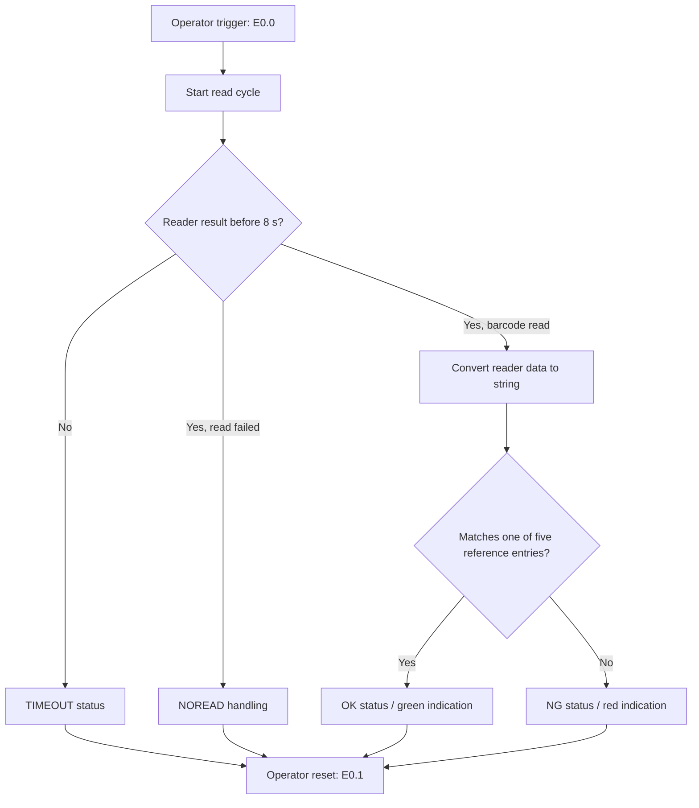

# Sequence and status notes

This document summarizes the behavior described in the project report and the visible TIA Portal LAD printout. It is not a substitute for online monitoring or a full code review.

## High-level sequence

## States and terms

| Term | Meaning documented for this project |
|---|---|
| `ReadActive` | Read cycle is active |
| `ReadComplete` | Reader read-completion signal |
| `ReadFail` | Reader read-failure signal |
| `OK` | Read barcode matches a stored reference string |
| `NG` | Barcode was read but did not match a stored reference |
| `NOREAD` | Reader read-failure handling |
| `TIMEOUT` | Read did not complete within the configured 8-second interval |
| `COMERR` / `LinkErrr` | Communication/link-error handling flags |
| `Reset` | Operator reset input at `E0.1` |

## Important implementation notes

- The project report describes the first five successfully read barcode strings as the reference list.
- The LAD printout contains a `TON` timeout with `T#8s`.
- The exported printout shows multiple status bits, counters, pulse timers and cleanup logic. Their precise scan-cycle interactions should be verified in TIA Portal.
- The overview describes a short buzzer on each read event and yellow/green/red indication. Confirm actual wiring and output mapping against the project I/O list.
- Do not infer safety behavior from these status flags. No safety-rated control design is documented here.
